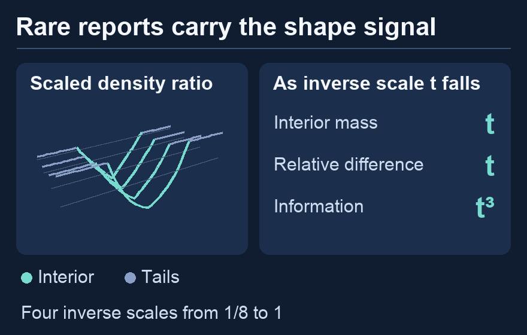

# The cube-root consistency threshold for Laplace mixture estimation

   

For mixing laws on a fixed known interval, the ordinary exact Laplace NPMLE is uniformly Wasserstein-consistent in probability exactly when the known positive nondecreasing noise-scale sequence is o(n^(1/3)). At the boundary, even consistency at both of two fixed laws is impossible.

[Read the paper](paper/manuscript.pdf) · [LaTeX source](paper/manuscript.tex) · [Original question](https://arxiv.org/pdf/2608.25997v1#page=14) · [Version DOI](https://doi.org/10.5281/zenodo.24572913)

## Explore the proof in 3D

Compare a point mass at zero with an equal mixture at −1 and 1. Their relative report-density difference is of order t inside the support interval and of order t² in the tails, where t is inverse scale. The interior itself has probability of order t. This makes the one-report information of order t³.

[Download the offline explorer](https://raw.githubusercontent.com/DannyExperiments/laplace-mixture-consistency-threshold/v1.0.0/visualization/laplace-shapes-explorer.zip) · [Explorer source](visualization/index.html) · [Worked comparison](proof/worked-laplace-shapes.md) · [GIF rendering source](visualization/render.py)

## Why the proof works

The likelihood factors into three category counts and conditional shapes. Tail observations have identical conditional densities for all mixing laws. The possible gain from the category counts stays bounded in probability. On the interior, compact shape separation and the conditional empirical CDF bound give a likelihood loss that outweighs the fluctuations if n times the inverse scale cubed diverges.

The matched-means pair gives the converse by a product-affinity bound. [Primary sources and earlier bounds](audits/public_safe_reports/LITERATURE.md)

## Reproduce the checks

    python3 -I scripts/verify_repository.py
    python3 -I verification/src/replay.py

[Recorded replay](verification/results/replay.txt) · [Scope](CLAIM_SCOPE_AND_LIMITATIONS.md) · [Reproducibility](REPRODUCIBILITY.md) · [Research disclosure](AI_DISCLOSURE.md)

## Cite

DannyExperiments. *The cube-root consistency threshold for Laplace mixture estimation*. Version 1.0.0, 27 November 2026. [Version DOI](https://doi.org/10.5281/zenodo.24572913).
